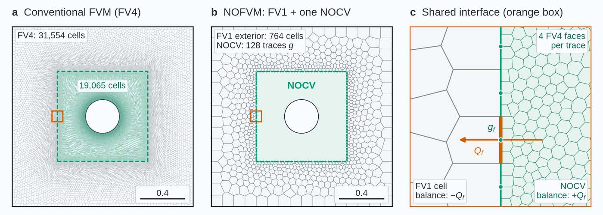
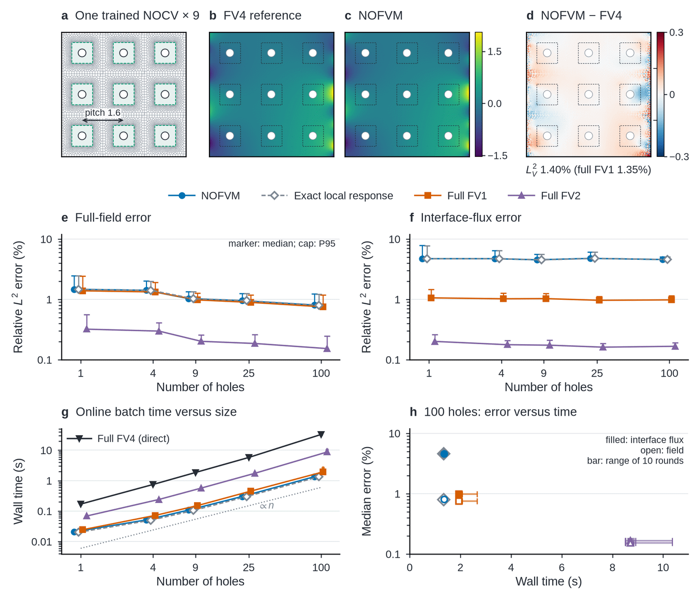

<h1 align="center">NOFVM: Neural-Operator Finite Volume Method</h1>

<p align="center">
  Pretrained neural operators as conservative, reusable control volumes inside a finite-volume solver.
</p>

<p align="center">
  <a href="LICENSE"></a>
  
  
  <a href="https://github.com/YupengQI99/NOFVM/releases/tag/v1.0"></a>
</p>

<p align="center">
  Code and result summaries for the paper<br>
  <b><i>Neural-operator finite volume method:<br>Conservative and efficient simulation with reusable local neural operators</i></b>
</p>

<p align="center">
  
</p>

<p align="center"><sub>
  <b>a</b>&nbsp;Conventional fine-grid FVM (FV4, 31,554 cells). <b>b</b>&nbsp;NOFVM: a 764-cell FV1 exterior and one NOCV that represents 19,065 fine cells and retains only its 128 interface traces. <b>c</b>&nbsp;Each interface flux enters the NOCV and the neighbouring cell with opposite signs.
</sub></p>

## Overview

NOFVM embeds pretrained neural operators in a conventional finite-volume solver. A **neural-operator control volume (NOCV)** replaces a subdomain that would otherwise need a fine grid, reconstructs the field inside it and exchanges shared interface fluxes with the surrounding finite-volume cells.

## Highlights

- **Conservative by construction.** Discrete conservation holds for any number of NOCVs and does not depend on the accuracy of the network predictions.
- **Reusable without retraining.** A single pretrained NOCV is reused in systems containing up to 100 holes.
- **Fast at scale.** For the 100-hole configuration, NOFVM reconstructs the full field with a median error of 0.8% and is 24 times faster than a direct fine-grid solve.
- **Unseen materials.** Material-conditioned NOCVs handle unseen materials from their training families.
- **Shocks.** In the Sod shock-tube test, a shock crosses an NOCV with a maximum speed error of 0.1%.

## Results at a glance

| Case | Problem | What is shown | Key result |
|:--|:--|:--|:--|
| B1,&nbsp;B2 | 1-D multiscale diffusion (B1) and advection–diffusion (B2) | One NOCV reused 8 times (B1) and 10 times (B2); 7 and 9 retained traces replace 2,048 and 2,560 fine-cell unknowns | Median field error 0.0517% (B1) and 0.0195% (B2) |
| C1,&nbsp;C2 | Heat conduction in perforated domains on polygonal meshes | One pretrained NOCV for a single hole (C1), reused without retraining in layouts with 1 to 100 holes (C2) | 100 holes: median field error 0.8%, 24 times faster than a direct fine-grid solve |
| D1&#8288;–&#8288;D3 | Darcy flow with lognormal, two-valued and elliptical-inclusion permeability | One material-conditioned NOCV per family, each tested on 32 unseen materials | Median pressure error 0.910% (D1), 0.845% (D2) and 0.554% (D3) |
| D4 | Darcy flow with pressure-dependent permeability | Kirchhoff transform with a learned linear response; 128 Newton unknowns | Median pressure error 0.0228% |
| Euler | Sod shock tube and six unseen Riemann problems | A shock passes through a dynamic NOCV at three positions; 16 conservative means replace 128 fine cells | Sod shock-speed error 0.058&#8288;–&#8288;0.102%; maximum balance defect 2.20&nbsp;×&nbsp;10⁻¹⁴ |

<p align="center">
  
</p>

<p align="center"><sub>
  One pretrained NOCV reused in layouts with 1 to 100 holes: the errors do not grow systematically with the number of copies (<b>e, f</b>), and the speed advantage over a direct fine-grid solve grows with the number of holes (<b>g</b>).
</sub></p>

## Repository structure

```text
NOFVM/
├── src/nofvm/                              # NOFVM library
│   ├── nofvm_2d.py                         # 2-D FV systems and exact local responses
│   ├── runtime.py                          # resource monitoring for long runs
│   ├── nofvm_multiscale_1d.py              # B1, B2: 1-D FV with affine neural subdomains
│   ├── nofvm_polygon_mesh.py               # C1, C2: Gmsh-seeded Voronoi control volumes
│   ├── nofvm_polygon_hybrid.py             # C1, C2: tiled polygon FV and NOCV coupling
│   ├── nofvm_hole.py                       # C1, C2: hole FV and static condensation
│   ├── nofvm_hole_operator.py              # C1, C2: hole NOCV operator
│   ├── nofvm_darcy.py                      # D1–D3: Darcy FV and NOCV coupling
│   ├── nofvm_darcy_operator.py             # D1–D3: material-conditioned NOCV operator
│   ├── nofvm_darcy_ellipse.py              # D3: elliptical-inclusion materials
│   ├── nofvm_darcy_nonlinear.py            # D4: Kirchhoff-consistent FV and coupling
│   ├── nofvm_darcy_nonlinear_operator.py   # D4: NOCV operator
│   ├── nofvm_euler_1d.py                   # Euler: FV solver and exact Riemann solution
│   ├── nofvm_euler_operator.py             # Euler: convolutional decoder, cosine basis
│   └── nofvm_euler_operator_v2.py          # Euler: mean-preserving positive decoder
├── scripts/                                # train, evaluate and time each experiment
├── tests/                                  # polygon mesh and coupled polygon solver
├── results/                                # metrics, histories and timings (JSON, CSV)
│   ├── multiscale_1d/                      # B1, B2
│   ├── polygon_mesh/                       # C1, C2: FV1, FV2 and FV4 polygon meshes
│   ├── polygon_hole/                       # C1, C2: training and evaluation
│   ├── polygon_timing/                     # C2: timing
│   ├── darcy_continuous/                   # D1
│   ├── darcy_jump/                         # D2
│   ├── darcy_ellipse/                      # D3
│   ├── darcy_nonlinear/                    # D4
│   └── euler_sod/                          # Euler
└── docs/figures/                           # figures for this README
```

## Installation

Install the PyTorch build that matches your CUDA version first (see [pytorch.org](https://pytorch.org)), then the remaining packages:

```bash
git clone https://github.com/YupengQI99/NOFVM.git
cd NOFVM
python -m pip install -r requirements.txt
```

The scripts add `src/` to the Python path themselves, so the `nofvm` package does not need to be installed.

## Data

Trained weights, meshes and field arrays (`.pt`, `.npz`, `.msh`, `.vtk`) are distributed as `NOFVM_data.tar.gz` (138&nbsp;MB) with [release v1.0](https://github.com/YupengQI99/NOFVM/releases/tag/v1.0). Download and unpack it in the repository root:

```bash
wget https://github.com/YupengQI99/NOFVM/releases/download/v1.0/NOFVM_data.tar.gz
sha256sum NOFVM_data.tar.gz
tar -xzf NOFVM_data.tar.gz
```

The SHA-256 checksum is `8c687b67a3b1d52004dd9de4af562717f6d51619c0559b9963776a5769d36223`. With `curl`, use `curl -LO` in place of `wget`.

The files are placed under `results/`, next to the JSON summaries. The polygon scripts read the meshes from `results/polygon_mesh`, and the timing script reads the trained hole operator from `results/polygon_hole/training`.

## Reproducing the experiments

Run all commands from the repository root. The examples write to `runs/`, which is ignored by git; use a new output directory for each run.

The training scripts and the Darcy evaluation scripts (D1–D4) require an NVIDIA GPU with CUDA and `nvidia-smi`. While running, the scripts check temperatures, free disk space and, in most cases, memory, and stop when a limit is reached (see [`src/nofvm/runtime.py`](src/nofvm/runtime.py)).

| Case | Scripts | Results |
|:--|:--|:--|
| B1,&nbsp;B2 | `run_nofvm_multiscale_1d.py` | [`results/multiscale_1d`](results/multiscale_1d) |
| C1,&nbsp;C2 | `generate_nofvm_polygon_mesh.py`, `train_nofvm_polygon_hole.py`, `evaluate_nofvm_polygon_hole.py`, `finish_nofvm_polygon_hole.py`, `time_polygon_reuse_rounds.py` | [`results/polygon_mesh`](results/polygon_mesh), [`results/polygon_hole`](results/polygon_hole), [`results/polygon_timing`](results/polygon_timing) |
| D1,&nbsp;D2 | `run_nofvm_darcy_linear.py`, `evaluate_nofvm_darcy_linear.py` | [`results/darcy_continuous`](results/darcy_continuous), [`results/darcy_jump`](results/darcy_jump) |
| D3 | `run_nofvm_darcy_ellipse.py`, `evaluate_nofvm_darcy_ellipse.py` | [`results/darcy_ellipse`](results/darcy_ellipse) |
| D4 | `run_nofvm_darcy_nonlinear.py`, `evaluate_nofvm_darcy_nonlinear.py` | [`results/darcy_nonlinear`](results/darcy_nonlinear) |
| Euler | `run_nofvm_euler_sod_v2.py` | [`results/euler_sod`](results/euler_sod) |

### B1, B2: one-dimensional multiscale problems

```bash
python scripts/run_nofvm_multiscale_1d.py --output runs/multiscale_1d
```

### C1, C2: perforated-domain heat conduction

The meshes come with the data archive in `results/polygon_mesh`, where the other polygon scripts read them. To regenerate the meshes and repeat the mesh checks (requires Gmsh and Shapely):

```bash
python scripts/generate_nofvm_polygon_mesh.py --output runs/polygon_mesh
```

Training, evaluation and figures:

```bash
python scripts/train_nofvm_polygon_hole.py --output runs/polygon_training
python scripts/evaluate_nofvm_polygon_hole.py --training runs/polygon_training \
    --output runs/polygon_reuse
python scripts/evaluate_nofvm_polygon_hole.py --training runs/polygon_training \
    --output runs/polygon_single --single-only
python scripts/finish_nofvm_polygon_hole.py --training runs/polygon_training \
    --evaluation runs/polygon_reuse --single runs/polygon_single --output runs/polygon_hole
```

Timing of the repeated-hole layouts (ten interleaved rounds on one logical CPU with one BLAS thread; the example pins CPU 19):

```bash
OPENBLAS_NUM_THREADS=1 OMP_NUM_THREADS=1 MKL_NUM_THREADS=1 taskset -c 19 \
    python scripts/time_polygon_reuse_rounds.py --output runs/polygon_timing \
    --count-factor-up-to 10
```

With `--count-factor-up-to 10`, the script also counts the nonzeros of the sparse LU factors of the 100-hole fine-grid system, which needs about 15 GiB of memory.

### D1–D3: heterogeneous Darcy flow

```bash
python scripts/run_nofvm_darcy_linear.py --family continuous    # D1
python scripts/run_nofvm_darcy_linear.py --family jump          # D2
python scripts/run_nofvm_darcy_ellipse.py --family ellipse      # D3

python scripts/evaluate_nofvm_darcy_linear.py --training runs/darcy_continuous/training
python scripts/evaluate_nofvm_darcy_linear.py --training runs/darcy_jump/training
python scripts/evaluate_nofvm_darcy_ellipse.py --training runs/darcy_ellipse/training
```

Training writes to `runs/darcy_<family>/training` and evaluation to `runs/darcy_<family>/evaluation`. Evaluation first checks that the source files and training outputs are unchanged since training, so run both steps from the same, unmodified checkout.

### D4: pressure-dependent Darcy flow

```bash
python scripts/run_nofvm_darcy_nonlinear.py --output runs/darcy_nonlinear/training
python scripts/evaluate_nofvm_darcy_nonlinear.py --training runs/darcy_nonlinear/training \
    --output runs/darcy_nonlinear/evaluation
```

### Euler: shock passage through a dynamic NOCV

```bash
python scripts/run_nofvm_euler_sod_v2.py --output runs/euler_sod
```

## Tests

```bash
python -m pytest tests
```

The tests require Gmsh and Shapely and are skipped when these are not installed.

## Hardware and software

The results in `results/` were obtained with:

- **Hardware:** NVIDIA RTX 4090 GPU, AMD Ryzen 9 7950X3D CPU
- **Software:** Python 3.11, PyTorch 2.7, NumPy 2.3, SciPy 1.16, Gmsh 4.15.2

## Citation

The paper is under review. Citation details will be added on publication.

## License

This project is released under the [MIT License](LICENSE).
